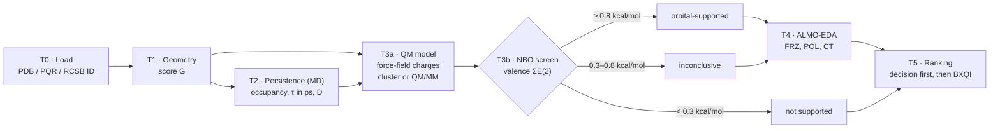

<div align="center">

# BondX Studio

### Is that halogen bond real? Screen geometric halogen contacts with quantum chemistry, in your browser.

**T0 Load → T1 Geometry → T2 Persistence → T3a QM model → T3b NBO screen → T4 ALMO-EDA → T5 Ranking**

[](https://compchemsk.github.io/BondX-Studio/)
&nbsp;

&nbsp;

&nbsp;


</div>

---

## What is BondX Studio?

BondX Studio screens halogen contacts (C–X···Y, with X = Cl, Br, or I) in proteins, ligands, trajectories, and crystals.
Most tools stop at distances and angles, although a short contact can also come from crowding, from a hydrogen bond to the halogen, or from a poor Lewis base.
BondX Studio therefore builds a quantum-chemical model of each contact with force-field protonation states and charges, writes the input files, and reads the NBO and ALMO-EDA outputs back onto the original atoms.
Its NBO screen sums the valence donation from the acceptor into the σ-hole and reports each contact as **orbital-supported**, **inconclusive**, or **not supported**.

The whole program is one HTML file (`index.html`) that needs no installation, no server, and no account.
Every assumption is shown on screen, every default is editable, and every change is logged.
BondX Studio does not run the quantum-chemistry jobs; you run them on your own computer or cluster.

**Online version:** <https://compchemsk.github.io/BondX-Studio/>

---

## Workflow



| Tier | What it does | Result |
|:---:|---|---|
| T0 | Reads PDB or PQR files, fetches PDB entries from RCSB, and removes virtual sites (EP, LP, and TIP4P M). | Clean structure |
| T1 | Tests every C–X bond against N, O, and S atoms and aromatic rings (Phe, Tyr, Trp, and nucleobases). Flags poor Lewis bases and short contacts. | Contacts with a geometric score *G* |
| T2 | Repeats the test in every frame of a DCD, multi-model PDB, or XYZ trajectory. | Occupancy, residence time in ps, persistence score *D*, and best frame |
| T3a | Cuts the QM region, keeps backbone amides, orients added O–H hydrogens, adds force-field charges, caps cut bonds, and writes inputs with an atom-by-atom manifest. | Job bundle |
| T3b | Reads the NBO second-order table and sums the valence donation from the T1 acceptor into σ*(C–X). Reports the Rydberg part and any competing X→σ*(N–H/O–H) donation beside it. | Supported, inconclusive, or not supported |
| T4 | Writes the Q-Chem ALMO-EDA input and reads the frozen, polarization, and charge-transfer energies (kcal/mol). | χ<sub>CT</sub> and mechanism |
| T5 | Ranks by the NBO decision and then by BXQI, a weighted geometric mean of the tiers that could be evaluated. | Ranking, HTML report, and JSON run record |

Two further pages screen many PDB entries (**Batch PDB**) and analyse crystals with periodic images (**Materials**).
A **Tutorial** inside the program explains every tier; its text is also in [`TUTORIAL.md`](TUTORIAL.md).

---

## What it can and cannot do

| It can | It cannot |
|---|---|
| Read PDB, PQR, CIF, XYZ, DCD, and multi-model PDB files | Run quantum-chemistry jobs |
| Find Cl, Br, and I contacts to O, N, S, protein rings, and nucleobases | Read GROMACS `.xtc` or AMBER `.nc` files directly (convert them once) |
| Screen many PDB entries in one batch | Give a tested result for fluorine (fluorine is off by default) |
| Build cluster and QM/MM models with ff14SB, ff19SB, or CHARMM36 charges | Assign the charge of basic amines or acidic azoles automatically (they are flagged; load a MOL2 file) |
| Write Gaussian 16 inputs (tested) and Q-Chem EDA inputs (tested) | Reweight biased (umbrella) trajectories |
| Read Gaussian NBO output and Q-Chem ALMO-EDA output | Tell whether a supported contact is attractive (keep the geometric limits) |
| Save and reload a session; write an HTML report and CSV tables | Replace a free-energy study of binding |

### Tested routes

| Task | Program | Status |
|---|---|---|
| NBO screen | Gaussian 16 with its built-in NBO 3.1 (`pop=nbo`) | Tested on 59 dimers, 138 scan points, and 89 protein models |
| ALMO-EDA | Q-Chem 6.2.2 | Tested |
| Batch screening | Local PDB files or PDB IDs | Tested on three test-set proteins (7, 2, and 2 contacts) |
| Crystal contacts and QM model | CIF with symmetry operators | Tested on a small test CIF |
| Counterpoise interaction energy | ORCA 5 or Gaussian 16 | Used in the paper; not read by the program |
| NBO screen | ORCA with NBO 7, Q-Chem with NBO | Untested; locked until you tick “Allow untested routes” |

---

## Quick start

1. Open <https://compchemsk.github.io/BondX-Studio/>, or download `index.html` and open it in a browser.
2. Press **Tutorial** in the top bar and read it once.
3. Open **T0 Load**. Type a PDB ID (for example, `1US0`), drop a file, or press **Load demo**.
4. Work through the tiers in the sidebar. Every page shows its assumptions and its settings.
5. Run the generated QM inputs on your cluster and drop the output files back into the program.
6. Press **Report**. The HTML report and the JSON run record hold every parameter, assumption, and result.

---

## Force-field charges and protonation

| Force field | Coverage |
|---|---|
| AMBER ff14SB and ff19SB | Protein, OL15 DNA, and OL3 RNA |
| CHARMM36 | Protein with standard terminal and protonation patches |
| Water | TIP3P, SPC/E, and OPC3 |
| Ions | Joung–Cheatham and Li–Merz (AMBER) and the CHARMM ion set |

- The ff14SB charges match the PDB2PQR reference files for every heavy atom (5855) and every hydrogen (5807) tested.
- The default protonation follows pH 7. Residue names in the file (HID, HIE, HIP, ASH, GLH, LYN, and CYX) and hydrogens in the file override the default. Every His within 8 Å of a halogen is listed with a warning; a PROPKA state can be loaded as a PQR file.
- Ligand charges come from a MOL2 or PQR file. Without such a file, one Kekulé structure gives the hydrogens and the charge, and the PDB formula (FORMUL) checks the hydrogen count. Basic amines, tetrazoles, and acyl sulfonamides are flagged.
- QM/MM: point charges of the whole structure by default, explicit MM hydrogens within 6 Å of the halogen, and the RC, RCD, Z1, Z2, or Z3 boundary scheme.

---

## Privacy

BondX Studio runs entirely in your browser. No structure, trajectory, or output file leaves your computer.
The program makes three kinds of network request: PDB downloads from RCSB when you ask for one, the 3Dmol.js viewer library from a public CDN, and, on the hosted website only, an anonymous page-view counter that never sees the data you load.
A copy opened from disk never contacts the counter.

---

## Repository contents

```
index.html               the complete application (open it in any browser)
TUTORIAL.md              the tutorial
LICENSE                  MIT license
app/
  src/engine.js          science engine: parsing, detection, charges, QM writers, parsers, and ranking
  src/ff_data.js         force-field charge tables (written by app/tools/extract_ff.py)
  src/ui.js              user interface
  src/template.html      page layout and styles
  src/qsm_lab_logo.png   logo of the Quantum Simulation of Molecules lab (footer)
  build.js               builds index.html from src/
  tests/                 120 engine tests, force-field reference test, and browser test
  examples/              demo complex
paper/
  Scripts/               every script of the paper (see paper/README_paper.md)
  BondX_paper_scripts.ipynb  all Python scripts of the paper in one notebook
  data/                  HAL59 dimers, rigid scans, and the protein test set
  results/               parsed QM results and analysis tables (CSV and JSON); results/v3/ for version 3.0 and results/extra/ for job sets G, J, and K
  qm_inputs/             all 2200 QM input files with their manifests
  tables/                generated LaTeX tables of the ESI
  checks/                independent re-implementations used for verification
```

### For developers

```bash
cd app
node build.js                    # writes index.html and dist/BondX_Studio.html
node tests/engine.test.js        # 120 engine tests (includes the force-field reference test)
node tests/ff_reference.test.js  # force-field charges against PDB2PQR, heavy atoms and hydrogens
python3 tests/e2e.py             # browser test (Playwright with Chromium)
```

Copy `app/index.html` to the top folder after a rebuild.

---

## Reproducing the paper

The folder `paper/` holds every script, data set, and parsed result of the paper, and `paper/README_paper.md` lists the scripts in order.
The QM outputs are large (about 400 MB), so the repository holds the inputs and the parsed results, which are enough to rebuild every figure and table.

---

## Citation

If BondX Studio helps your work, please cite:

> Karmakar, S.; Mishra, S. BondX Studio: Screening Geometric Halogen Contacts with Force-Field-Consistent QM Models, NBO Analysis, and ALMO-EDA. *J. Chem. Inf. Model.* (submitted).

and the archived release of version 3.0.0 (Zenodo DOI to be added with the release).

---

<div align="center">

**Authors:** Soumyajit Karmakar and Sabyashachi Mishra · Department of Chemistry, IIT Kharagpur, India
Contact: [soumyajitkarmakar.iit@gmail.com](mailto:soumyajitkarmakar.iit@gmail.com) · [@compchemsk](https://github.com/compchemsk)

</div>
