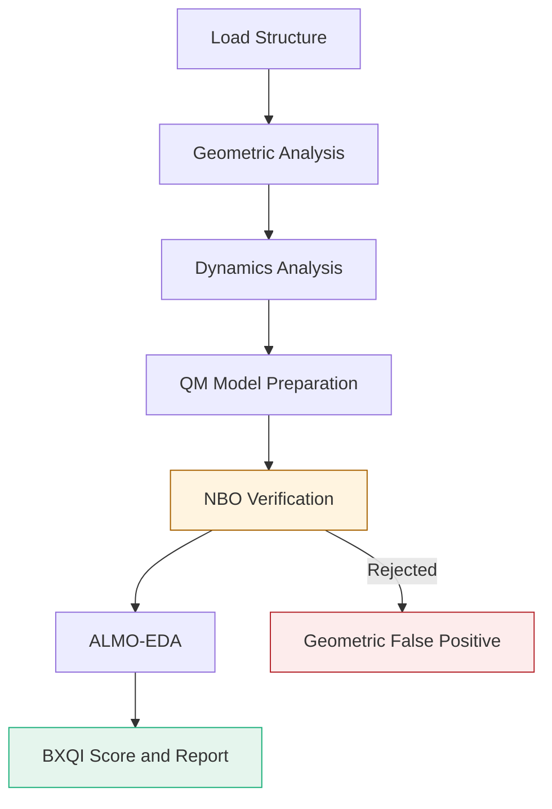

# 🔷 BondX Studio

### Halogen-Bond Analysis from Geometry to Electronic Structure

**Structure → Geometry → Dynamics → NBO → ALMO-EDA → BXQI**

---

## ✨ About BondX Studio

**BondX Studio** is a browser-based tool for identifying and characterising halogen bonds (C–X···Y, where X = Cl, Br, I).

It analyses halogen bonds in:

- Protein–ligand complexes
- Molecular dynamics (MD) trajectories
- Crystal structures

Unlike tools that rely only on distances and angles, BondX examines the electronic nature of each interaction.

It combines geometric analysis, molecular dynamics, Natural Bond Orbital (NBO) analysis, and ALMO Energy Decomposition Analysis (ALMO-EDA).

The final result is a transparent **BondX Quality Index (BXQI)**.

BondX runs directly in your browser. No installation, server, or user account is required.

---

## 🧭 Analysis Workflow

### Main Analysis Steps

| Step | Analysis | Description |
|:---:|---|---|
| 1 | Structure | Load PDB/PQR files or retrieve structures using a PDB ID. |
| 2 | Geometry | Identify potential halogen bonds using distance and angular criteria. |
| 3 | Dynamics | Analyse contacts across trajectories. Calculate occupancy and residence time. |
| 4 | QM Model | Prepare QM clusters and generate Gaussian, ORCA, or Q-Chem input files. |
| 5 | NBO | Check orbital donation into the antibonding σ*(C–X) orbital. |
| 6 | ALMO-EDA | Analyse polarization and charge-transfer contributions. |
| 7 | BXQI | Combine the evidence into a final score and report. |

Two additional tools are available:

- **Batch PDB:** Screen multiple protein structures.
- **Materials:** Analyse CIF and XYZ crystal structures, including periodic images.

---

## 🚀 Getting Started

You can use BondX Studio in two ways.

**Option 1: Use online**

Open:

[https://compchemsk.github.io/BondX-Studio](https://compchemsk.github.io/BondX-Studio)

**Option 2: Run locally**

1. Download `index.html`.
2. Open it in a modern web browser.
3. Load your structure or use the built-in demo.
4. Select the analysis steps from the sidebar.
5. Explore the results and export your reports.

You can load a PDB file, a PQR file, or enter a PDB ID (for example, `1US0`).

BondX also supports trajectory analysis using DCD, multi-model PDB, and XYZ files.

### What can you export?

- Interactive HTML reports
- JSON run records
- CSV analysis data
- Quantum chemistry input files

You can also save your session and reuse your analysis settings.

---

## ⚛️ Force Fields and Protonation

BondX uses established force-field parameters for molecular modelling.

| Force Field | Application |
|---|---|
| AMBER ff14SB / ff19SB | Protein |
| AMBER OL15 / OL3 | DNA / RNA |
| CHARMM36 | Protein |
| TIP3P / SPC/E / OPC3 | Water |
| Joung–Cheatham / Li–Merz | Ions |

### Key Features

- AMBER charges are checked against independent PDB2PQR reference data.
- Automatic protonation using pH-7 rules.
- Support for HID, HIE, HIP, ASH, GLH, LYN, and CYX residues.
- Automatic disulfide detection.
- Individual residue protonation overrides.
- Handling of missing hydrogen charges.
- Ligand charges from MOL2 or PQR files.
- QM/MM boundary options: RC, Z1, Z2, Z3, or none.

---

## 🔬 Quantum Chemical Analysis

BondX connects structural observations with electronic structure analysis.

**NBO Analysis**

Checks second-order perturbation energies associated with donation into σ*(C–X). This provides an electronic verification step for potential halogen bonds.

**ALMO-EDA**

Separates the interaction into frozen, polarization, and charge-transfer contributions. This helps identify the physical origin of the interaction.

**BXQI**

Combines geometric, dynamical, and electronic evidence into a single score ranging from 0 to 100.

---

## 🔒 Privacy

BondX is designed to run locally in your browser.

- Your molecular structures and trajectories stay on your computer.
- No account or server is required for local analysis.
- Network requests are used only for PDB retrieval and the 3D viewer library.
- The hosted website records an anonymous visit count. It does not record the molecular data you load.

---

## 📖 Citation

If BondX Studio contributes to your research, please cite:

> Karmakar, S.; Mishra, S. *BondX Studio: Tiered Geometric, Dynamic and Electronic Characterisation of Halogen Bonds.* Manuscript in preparation.

---

## 📁 Repository

The repository contains three files:

| File | Purpose |
|---|---|
| `index.html` | Complete BondX Studio application |
| `README.md` | Project description and user guide |
| `LICENSE` | Licensing information |

No additional source files or installation scripts are required.

---

### Developed by

**Soumyajit Karmakar**

Department of Chemistry  
Indian Institute of Technology Kharagpur

📧 soumyajitkarmakar.iit@gmail.com

🐙 GitHub: [@compchemsk](https://github.com/compchemsk)

---

**From Molecular Geometry to Electronic Evidence.**

🌿 Have a Good Day. Thank You.

