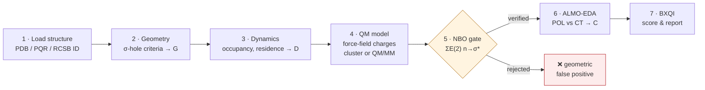

<div align="center">
🔷 BondX Studio
Halogen-bond characterisation, from crystal structure to electronic structure, in your browser
Geometry → Dynamics → QM model → NBO gate → ALMO-EDA → Score

 

 

</div>
---
✨ What is BondX Studio?
BondX Studio finds halogen bonds (C–X···Y, X = Cl, Br, I) in protein–ligand complexes, MD trajectories and crystals. It then checks each one, step by step, with quantum chemistry.
Most tools stop at distances and angles. BondX goes further. It asks whether there is real charge transfer into the halogen σ-hole (NBO), and whether the bond is driven by polarization or charge transfer (ALMO-EDA). It then combines all the evidence into one transparent score, the BXQI.
Everything runs inside a single HTML file. There is no installation, no server and no account.
---
🧭 Workflow

Step	What it does	Output
1	Reads PDB/PQR files or fetches an entry from RCSB. Lets you select chains and shows the composition.	Clean structure
2	Tests every C–X against N/O/S and aromatic acceptors using distance and angle criteria.	Contacts with a geometric score G
3	Re-tests every frame of a DCD, multi-model PDB or XYZ trajectory.	Occupancy, residence time, best frame, D
4	Cuts out the QM region, protonates it from force-field templates, caps cut bonds and writes Gaussian / ORCA / Q-Chem inputs.	Job bundle with an atom-by-atom manifest
5	Reads the NBO second-order perturbation table and adds up donation into σ*(C–X).	Verified or rejected, E
6	Writes the Q-Chem EDA2 input and reads frozen / polarization / charge-transfer energies.	χ<sub>CT</sub>, mechanism, C
7	Combines the tiers by a weighted geometric mean.	BXQI (0–100), HTML report, run record
Two extra tools are included:
Batch PDB screens many entries at once.
Materials analyses CIF/XYZ crystals with periodic images.
---
🚀 Quick start
Open 👉 compchemsk.github.io/BondX, or download `index.html` and double-click it.
Load a structure: type a PDB ID (e.g. `1US0`), drop a file, or press Load built-in demo complex.
Click through the steps in the left sidebar. Each page shows:
📋 Assumptions used in this step, which update live as you change settings
⚙️ Settings, where every default can be edited, changed values are highlighted, and each value can be reset with one click
📊 Results, with interactive charts, a 3D view and CSV export
Run the generated QM inputs on your cluster, then drop the output files back into BondX.
Export the HTML report and the JSON run record, which together hold every parameter, assumption and step.
> 💡 **Tip:** use *Save session* to carry on later. *All parameters → Export* saves your settings so that a whole project uses the same protocol.
---
⚛️ Force-field charges and protonation
BondX takes charges and residue templates from established force fields:
Force field	Covers
AMBER ff14SB · ff19SB	protein, plus OL15 DNA and OL3 RNA
CHARMM36	protein (with standard terminal and protonation patches)
Water	TIP3P, SPC/E, OPC3
Ions	Joung–Cheatham / Li–Merz (AMBER), CHARMM ion set
✅ The AMBER charges were checked against the independent PDB2PQR reference data and match exactly.
✅ Protonation:
pH-7 rules by default;
HID/HIE/HIP and ASH/GLH/LYN/CYX are read from your file;
disulfides are detected automatically;
charged termini (including ACE/NME caps) are handled;
each residue can be overridden individually.
✅ Missing hydrogens: their charge is added to the parent heavy atom, so every residue keeps an integer charge.
✅ Ligands: charges come from your MOL2 file (e.g. AM1-BCC) or from a PQR file. Without either, the ligand's net charge is set from simple chemical rules.
✅ QM/MM boundary: RC (Lin–Truhlar, which conserves charge), Z1, Z2, Z3 or none. Residues split by the cut are neutralised.
---
🔒 Privacy
BondX runs entirely in your browser. No structure, trajectory or output file leaves your computer.
The only network requests are PDB-ID downloads from RCSB and the 3D viewer library.
On the hosted website, an anonymous visit count is recorded. It never includes any data you load.
---
🧪 For developers
```bash
node build.js                    # rebuild index.html / dist/BondX_Studio.html from src/
node tests/make_test_data.js     # create test files
node tests/engine.test.js        # engine tests
node tests/ff_reference.test.js  # force-field charges vs PDB2PQR reference
python3 tests/e2e.py             # browser end-to-end test (Playwright)
```
```
src/engine.js      science engine (parsing, detection, charges, QM writers, parsers, scoring)
src/ff_data.js     force-field charge tables (generated by tools/extract_ff.py)
src/ui.js          user interface
src/template.html  page layout and styles
docs/              validation and test plan
```
---
📖 Citation
If BondX Studio helps your work, please cite:
> Karmakar, S.; Mishra, S. *BondX Studio: tiered geometric, dynamic and electronic characterisation of halogen bonds.* (manuscript in preparation)
---
<div align="center">
Inventor: Soumyajit Karmakar · Department of Chemistry, IIT Kharagpur
📧 soumyajitkarmakar.iit@gmail.com · 🐙 @compchemsk
Have a Good Day. Thank You. 🌿
</div>
