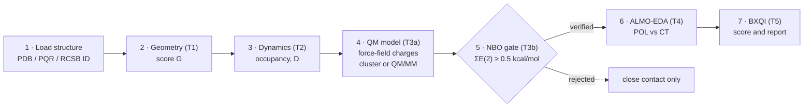

<div align="center">

# BondX Studio

### Is that halogen bond real? From geometric contacts to verified halogen bonds, in your browser.

**Geometry → Dynamics → QM model → NBO gate → ALMO-EDA → BXQI**

[](https://compchemsk.github.io/BondX-Studio/)
&nbsp;

&nbsp;

&nbsp;


</div>

---

## What is BondX Studio?

BondX Studio checks halogen bonds (C–X···Y, X = Cl, Br, I) in proteins, ligands, trajectories and crystals.
Most tools stop at distances and angles. BondX Studio goes further.
It builds a quantum-chemical model of each contact with force-field protonation and charges.
It writes the input files for Gaussian 16, ORCA and Q-Chem.
It reads the NBO and ALMO-EDA outputs.
It keeps a contact only with real donation from the acceptor into the σ*(C–X) orbital.
It combines all the evidence into one transparent score, the BondX quality index (BXQI).

The whole program is one HTML file (`index.html`).
It needs no installation, no server and no account.
Every assumption is shown on screen. Every default value is editable. Every change is logged.

**Online version:** <https://compchemsk.github.io/BondX-Studio/>

---

## Workflow



| Step | Tier | What it does | Result |
|:---:|:---:|---|---|
| 1 | T0 | Reads PDB or PQR files. Fetches PDB entries from RCSB. Removes virtual sites (EP, LP, TIP4P M). | Clean structure |
| 2 | T1 | Tests every C–X bond against N, O, S and aromatic acceptors. | Contacts with a geometric score G |
| 3 | T2 | Repeats the test in every frame of a DCD, multi-model PDB or XYZ trajectory. | Occupancy, residence time, best frame |
| 4 | T3a | Cuts the QM region, adds hydrogens and force-field charges, caps cut bonds, writes inputs. | Job bundle with an atom-by-atom manifest |
| 5 | T3b | Reads the NBO second-order table. Adds the donation from the T1 acceptor into σ*(C–X). | Verified or rejected |
| 6 | T4 | Writes the Q-Chem ALMO-EDA input. Reads the frozen, polarization and CT energies. | χ_CT and mechanism |
| 7 | T5 | Combines the tiers by a weighted geometric mean. | BXQI (0–100), grade A–D, HTML report |

Two further pages screen many PDB entries (**Batch PDB**) and analyse crystals with periodic images (**Materials**).
A five-page **Tutorial** inside the program explains every step. Its text is also in [`TUTORIAL.md`](TUTORIAL.md).

---

## What it can and cannot do

| It can | It cannot |
|---|---|
| Read PDB, PQR, CIF, XYZ, DCD and multi-model PDB files | Run quantum-chemistry jobs (you run them on your computer or cluster) |
| Find Cl, Br and I halogen bonds to O, N, S and aromatic rings | Read GROMACS `.xtc` or AMBER `.nc` files directly (convert them once) |
| Screen many PDB entries in one batch | Give a tested result for fluorine (fluorine is off by default) |
| Build cluster and QM/MM models with ff14SB, ff19SB or CHARMM36 charges | Replace a free-energy study of binding |
| Write Gaussian, ORCA and Q-Chem inputs | Decide on a weak contact without the NBO tier |
| Read Gaussian NBO output and Q-Chem ALMO-EDA output | |
| Save and reload a session; write an HTML report and CSV tables | |

### Tested routes

| Task | Program | Status |
|---|---|---|
| NBO gate | Gaussian 16 with NBO 3.1 (`pop=nbo`) | Tested on 59 benchmark dimers and 9 protein contacts |
| ALMO-EDA | Q-Chem 6.2 | Tested |
| Batch screening | Local PDB files or PDB IDs | Tested on three test-set proteins (7, 2 and 2 halogen bonds) |
| Crystal contacts and QM model | CIF with symmetry operators | Tested on a small test CIF |
| Counterpoise binding energy | ORCA 5 or Gaussian 16 | Used in the paper; not read by the program |
| NBO gate | ORCA with NBO 7 | Input written; not tested |
| NBO gate | Q-Chem with NBO 5 (`$nbo E2PERT $end`) | Input written; not tested |

The program shows a caution for every untested route.

---

## Quick start

1. Open <https://compchemsk.github.io/BondX-Studio/>. Alternatively, download `index.html` and open it in a browser.
2. Press **Tutorial** in the top bar. Read the five pages once.
3. Open **1 Load structure**. Type a PDB ID (for example `1US0`), drop a file, or press **Load demo**.
4. Press the button at the bottom right of each page. Every page shows its assumptions and its settings.
5. Run the generated QM inputs on your cluster. Drop the output files back into the program.
6. Press **Report**. The HTML report and the JSON run record hold every parameter, assumption and result.

---

## Force-field charges and protonation

| Force field | Coverage |
|---|---|
| AMBER ff14SB and ff19SB | Protein, OL15 DNA, OL3 RNA |
| CHARMM36 | Protein with standard terminal and protonation patches |
| Water | TIP3P, SPC/E, OPC3 |
| Ions | Joung–Cheatham and Li–Merz (AMBER), CHARMM ion set |

- The AMBER charges match the PDB2PQR reference charges exactly (5855 heavy atoms).
- The default protonation follows pH 7. Residue names in the file (HID, HIE, HIP, ASH, GLH, LYN, CYX) override the default.
- Missing hydrogens add their charge to the parent heavy atom. Every residue keeps an integer charge.
- Ligand charges come from a MOL2 or PQR file. Without such a file, one Kekulé structure gives the hydrogens and the charge. The PDB formula (FORMUL) checks the hydrogen count.
- QM/MM boundary schemes: RC (charge conserving), Z1, Z2, Z3 or none.

---

## Privacy

BondX Studio runs entirely in your browser. No structure, trajectory or output file leaves your computer.
The only network requests are PDB downloads from RCSB and the 3Dmol.js viewer library.
The hosted website counts anonymous page visits. The count never includes any data you load.

---

## Repository contents

```
index.html               the complete application (open it in any browser)
TUTORIAL.md              the five-page tutorial
LICENSE                  MIT license
app/
  src/engine.js          science engine: parsing, detection, charges, QM writers, parsers, scoring
  src/ff_data.js         force-field charge tables (written by app/tools/extract_ff.py)
  src/ui.js              user interface
  src/template.html      page layout and styles
  build.js               builds index.html from src/
  tests/                 97 engine tests, force-field reference test, browser test
  examples/              demo complex
paper/
  Scripts/               every script of the paper (see paper/README_paper.md)
  data/                  HAL59 dimers, rigid scans, protein test set
  results/               parsed QM results and analysis tables (CSV, JSON)
  qm_inputs/             all 2200 QM input files with their manifests
  tables/                generated LaTeX tables of the ESI
  checks/                independent re-implementations used for verification
```

### For developers

```bash
cd app
node build.js                    # writes index.html and dist/BondX_Studio.html
node tests/engine.test.js        # 97 engine tests
node tests/ff_reference.test.js  # force-field charges against PDB2PQR
python3 tests/e2e.py             # browser test (Playwright with Chromium)
```

Copy `app/index.html` to the top folder after a rebuild.

---

## Reproducing the paper

The folder `paper/` holds every script, data set and parsed result of the paper.
`paper/README_paper.md` lists the scripts in order.
The QM outputs are large (about 400 MB). The repository therefore holds the inputs and the parsed results.
The parsed results are enough to rebuild every figure and table.

---

## Citation

If BondX Studio helps your work, please cite:

> Karmakar, S.; Mishra, S. BondX Studio: From Geometric Contacts to Verified Halogen Bonds with Force-Field-Consistent QM Models, NBO and ALMO-EDA. *J. Chem. Inf. Model.* (submitted).

---

<div align="center">

**Authors:** Soumyajit Karmakar and Sabyashachi Mishra · Department of Chemistry, IIT Kharagpur, India
Contact: [soumyajitkarmakar.iit@gmail.com](mailto:soumyajitkarmakar.iit@gmail.com) · [@compchemsk](https://github.com/compchemsk)

</div>
